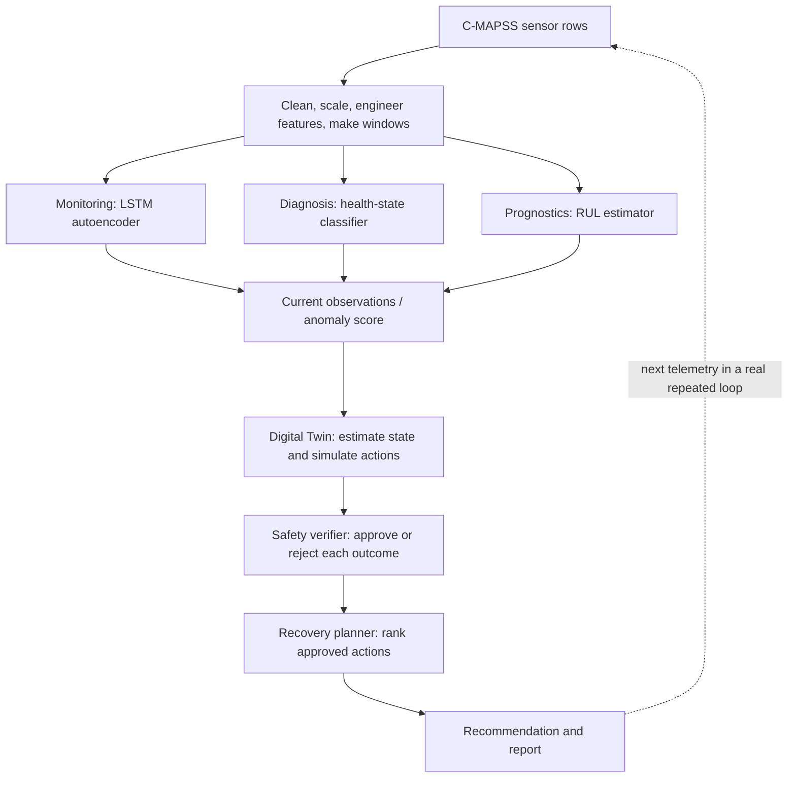

# Project Learning Notes: Digital-Twin-Verified Multi-Agent AI

These notes explain the project from the beginning, using the code that is in this repository and the latest successful run. The explanations start with the simple idea, then connect it to the actual Python implementation.

## 1. The project in one sentence

The project reads simulated turbofan-engine sensor history, looks for unusual behavior, estimates engine health and remaining life, simulates possible actions in a small Digital Twin, and lets a separate safety checker approve or reject those simulated actions.

Think of it as a team:

- **Sensors** report what the engine is doing.
- **Monitoring** asks, “Does this look different from healthy behavior?”
- **Diagnosis** asks, “Which health stage does this data look like?”
- **Prognostics** asks, “How much useful life may remain?”
- **Recovery planning** asks, “Which available response looks best?”
- **The Digital Twin** asks, “What might happen if we choose that response?”
- **Safety verification** checks, “Does the simulated result break a safety rule?”

The project is a research prototype using NASA C-MAPSS data. It does not connect to an actual engine, aircraft, or actuator.

## 2. A map of the architecture



The closed-loop script demonstrates a decision step. It does not send a command to real equipment or repeatedly control a real engine.

## 3. Basic words used throughout the project

| Term | Plain-language meaning | Project example |
|---|---|---|
| Artificial intelligence (AI) | Software that performs a task that normally needs some human reasoning. | The system combines learned predictions with a planner and safety checks. |
| Machine learning (ML) | A way to learn patterns from examples instead of writing every prediction rule by hand. | The Random Forest learns how sensor-window summaries relate to RUL. |
| Deep learning | ML using layered neural networks. | The LSTM autoencoder is a neural network. |
| Feature | A number supplied to a model as an input. | `sensor_9`, or the mean of `sensor_9` across a 30-cycle window. |
| Label / target | The answer the model is trained to predict. | RUL is the regression target; healthy/degraded/critical is the diagnosis label. |
| Classification | Choose a category. | Diagnosis chooses one health state. |
| Regression | Predict a number. | Prognostics predicts remaining cycles. |
| Time series | Measurements recorded in time order. | One engine’s sensor values over cycles 1, 2, 3, and so on. |
| Window | A short chunk of consecutive measurements. | A 30-cycle window contains 30 rows for one engine. |
| LSTM | A neural network designed to process sequences while carrying useful information from earlier time steps. | The monitor learns a healthy sequence pattern; the prognostics comparator reads sensor sequences. |
| Autoencoder | A model trained to reproduce its input. | The monitor learns to reconstruct healthy windows. Poor reconstruction can signal unusual behavior. |
| Anomaly | Something that differs from the learned normal pattern. | A high reconstruction error is an anomaly score; it is not proof of a broken component. |
| Agent | A component with a clear job, inputs, and outputs. | The Diagnosis Agent converts feature windows into health-state probabilities. |
| Agentic system | Multiple components that observe, reason, choose actions, and check outcomes. | This project has a modular multi-agent flow, but it does not use an LLM or autonomous tool-calling agent. |
| Digital Twin | A software model of a system used to estimate its state and simulate possible outcomes. | The project learns a one-step sensor transition and applies explicit action assumptions. |
| Safety verifier | A separate rule checker that can block an action even if the planner likes it. | It rejects high risk, excessive uncertainty, excessive drift, or invalid values. |
| Telemetry | Measurements sent by equipment. | The C-MAPSS sensor values and operating settings. |
| RUL | Remaining Useful Life: estimated cycles until failure. | A target of 25 means about 25 cycles remain in the benchmark trajectory. |

## 4. The data: what the model sees

### C-MAPSS rows

Each row describes one engine at one cycle. There are 26 columns:

1. `unit_id`: which engine this row belongs to.
2. `cycle`: the time/order number for that engine.
3. `op_setting_1` to `op_setting_3`: operating conditions.
4. `sensor_1` to `sensor_21`: sensor measurements.

There are four dataset subsets:

| Subset | Operating conditions | Fault modes |
|---|---:|---:|
| FD001 | 1 | 1 |
| FD002 | 6 | 1 |
| FD003 | 1 | 2 |
| FD004 | 6 | 2 |

The training engines run to failure. The test engines stop before failure, and `RUL_FD00x.txt` supplies the remaining life at each test engine’s last observed cycle.

### How RUL labels are made

For a training row, RUL is the engine’s last cycle minus the row’s current cycle:

```python
final_cycle = result.groupby("unit_id")["cycle"].transform("max")
result["rul"] = final_cycle - result["cycle"]
```

For a test row, the official RUL file gives the remaining life at the last observed cycle. Earlier rows have that many cycles plus the distance to the last observed cycle:

```python
result["rul"] = terminal_rul + final_cycle - result["cycle"]
```

These calculations are in `src/cmapss_data.py`. RUL is a benchmark label, not a sensor reading.

### Why data is split by engine

Rows from one engine are related. If early rows from engine 7 were used for training and later rows from engine 7 were used for validation, the model would get an unfairly familiar example. The project splits whole engine IDs first:

```python
split = split_engine_units(full_train, validation_fraction=0.2, seed=42)
train_frame = full_train[full_train["unit_id"].isin(split.train_units)]
validation_frame = full_train[full_train["unit_id"].isin(split.validation_units)]
```

That separation prevents a common problem called **data leakage**: information from the evaluation data accidentally influencing training.

### Scaling and windows

Sensor values have different ranges. A scaler transforms them onto comparable scales. It must be fitted on training data only, then reused unchanged on validation and test data:

```python
scaler = fit_feature_scaler(train_frame, features)
train_scaled = transform_features(train_frame, features, scaler)
validation_scaled = transform_features(validation_frame, features, scaler)
```

Fitting a scaler on test data would leak information about the test distribution into training.

A 30-cycle window turns rows into a sequence. The model input shape is:

```text
(number_of_windows, 30 time steps, number_of_features)
```

Windows are made separately for each engine, so a window never mixes two engines. The helper also ensures each engine’s final observed cycle is included for terminal test scoring.

For classical models, `summarize_windows` compresses each sequence into six groups of numbers per feature:

- last value
- mean
- standard deviation
- minimum
- maximum
- slope from first to last point

For the Random Forest baseline, those summaries turn a sequence into a fixed-length feature vector.

## 5. What the ML words mean in this project

### Training, validation, and test

- **Training data** teaches the model its parameters.
- **Validation data** helps select settings or thresholds. It must stay separate from training.
- **Test data** is the final check after choices have been made. It should not be used to tune the model.

The LSTM monitor splits training engines into fit, calibration/early-stopping, and held-out validation groups. The official C-MAPSS test engines remain separate. Research cross-validation uses only training engines and keeps the official test evaluation separate.

### Normalization

Standardization roughly subtracts a feature’s training mean and divides by its training standard deviation:

```text
scaled_value = (value - training_mean) / training_standard_deviation
```

It helps models compare sensors with different numerical ranges. It does not make the measurements physically equivalent.

### Overfitting and early stopping

An overfit model memorizes its training examples but performs poorly on new engines. Early stopping watches validation loss and keeps the checkpoint that performed best there. The monitor uses this approach and saves its best weights, scaler, configuration, and history.

## 6. Stage 1: preprocessing, step by step

The data pipeline in `src/cmapss_data.py` does the following:

1. Reads the whitespace-separated C-MAPSS files.
2. Assigns clear column names.
3. Adds training or test RUL labels.
4. Splits by whole engine IDs.
5. Finds constant features using training engines.
6. Fits a scaler using training data.
7. Builds per-engine time windows.
8. Optionally computes summary features for models that need fixed-size vectors.

The audit command checks row counts, missing values, non-finite values, duplicate engine/cycle pairs, and cycle order. The latest audit found no missing/non-finite values, duplicates, non-monotonic trajectories, or missing cycles across FD001–FD004.

## 7. Stage 2: the four agents

### Agent 1 — LSTM-AE Monitoring Agent

**Question it answers:** “Does this window look unlike the healthy patterns I learned?”

The monitor is trained on early-life windows treated as healthy. In the current configuration, windows end by cycle 60 and contain 30 cycles. It encodes a sequence into a smaller internal representation, then decodes that representation back into a reconstructed sequence.

If the reconstruction is close to the original, the window looks familiar. If it is poor, the reconstruction error is larger and the behavior may be anomalous.

The essential training operation is:

```python
prediction = model(batch)
loss = loss_fn(prediction, batch)  # target is the input itself
loss.backward()
clip_grad_norm_(model.parameters(), max_norm=5.0)
optimizer.step()
```

The LSTM learns to reconstruct healthy sensor windows. The training script uses a fixed seed, early stopping, and saves the best checkpoint. In the latest run, it used **PyTorch 2.15.0+cpu**; CUDA was unavailable. The NumPy implementation remains as a fallback.

After training, it computes a healthy calibration score and sets a threshold at the 99th percentile:

```python
threshold = np.percentile(healthy_calibration_scores, 99)
raw_alert = anomaly_score > threshold
```

One unusual window can be noise, so an alert is confirmed only after three consecutive alert windows. This is called **persistence filtering**.

An anomaly explanation can identify which sensors contributed most to the reconstruction error. That means “these measurements looked unusual,” not “sensor 9 proves component X failed.”

Latest FD001 test result:

- 33 engines had degraded windows; 28 were detected (84.8% engine detection).
- Window precision: 0.820; recall: 0.659; F1: 0.731.
- Healthy-window false-alarm rate: 4.36%.
- Median alert lead time: 65 cycles.
- The PCA baseline reported 2% engine detection, 0% healthy false alarms, and 27.5-cycle median lead time on the same test split.

For this run, the 100 training engines were divided into 72 fit engines, 8 calibration/early-stopping engines, and 20 held-out validation engines; the official test contains 100 engines. The scaler used 4,320 healthy training rows. The learned anomaly threshold was **0.711231** reconstruction-error units. That number only makes sense with this model, scaler, features, and window configuration; it is not a universal sensor threshold.

The comparison is useful, but still one benchmark split. The early-life-is-healthy assumption and 99th-percentile threshold are design choices that need more evaluation.

### Agent 2 — Diagnosis Agent

**Question it answers:** “Which broad health stage does this window resemble?”

The current diagnosis model is a `HistGradientBoostingClassifier`. It predicts project-defined states from the RUL value at the end of a window:

```python
if rul <= 25:
    state = "critical"
elif rul <= 125:
    state = "degraded"
else:
    state = "healthy"
```

The actual code uses vectorized NumPy selection. The thresholds are chosen by this project; C-MAPSS does not supply these health-state labels. Therefore this agent does **not** identify a physical failed component.

Training class weights are calculated so rare classes receive more influence. At prediction time, the classifier can return a probability for each state. The code can mark a prediction `uncertain` if confidence is low or probability entropy is high.

Latest validation window results: accuracy 0.784, balanced accuracy 0.791, macro-F1 0.784, weighted-F1 0.787. It also records per-class precision/recall/F1, a confusion matrix, Brier score, and expected calibration error.

Why report multiple metrics? Accuracy can hide a model that performs well on common classes but badly on a rare class. Macro-F1 gives each class equal weight; weighted-F1 gives larger classes more influence.

### Agent 3 — Prognostics Agent

**Question it answers:** “How many cycles of useful life may remain?”

The main deployed baseline is a Random Forest with 150 trees. Each tree sees a 30-cycle window summary and predicts RUL. The agent averages the tree predictions. Variation between the trees is recorded as a rough uncertainty estimate, but tree spread alone is not a calibrated probability interval.

The fitted path in `src/prognostics.py` is essentially:

```python
scaler = fit_feature_scaler(training_frame, feature_columns)
scaled = transform_features(training_frame, feature_columns, scaler)
windows, targets, _ = make_windows(scaled, feature_columns, window_size=30)
summary = summarize_windows(windows)
model = RandomForestRegressor(n_estimators=150, random_state=42)
model.fit(summary, targets)
```

The project also trains a NumPy sequence-to-RUL LSTM as a comparison. It reads the window as a sequence and predicts one number. In the current implementation, that comparator is NumPy-based; it is not the PyTorch monitoring model.

### How prognostics intervals are calibrated

The code selects one pseudo-current validation window per engine across RUL values from 0 to 125. It computes absolute errors on those held-out validation windows and chooses a finite-sample 95% quantile, called `q95`.

The calibrated interval is:

```python
lower = max(predicted_rul - q95, 0)
upper = predicted_rul + q95
```

The true validation RUL is used only to select an evaluation point across the RUL range. It is not an input feature to the model. This design avoids calibrating only on run-to-failure endpoints, where training RUL is always zero.

Latest FD001 official-test terminal results:

- MAE 20.52 cycles; RMSE 28.09; R² 0.543; NASA score 6816.1.
- Engine-bootstrap 95% MAE confidence interval: 16.88–24.44 cycles.
- Calibrated interval coverage: 97%; mean interval width: 114.31 cycles.

The interval is wide. Its 97% coverage is above the nominal 95%, but that does not mean every individual prediction is 97% certain. Coverage is an aggregate property of the evaluation sample.

### Agent 4 — Recovery Planning Agent

**Question it answers:** “Among the actions the project knows about, which has the lowest score while staying within the risk budget?”

The planner does not invent actions or learn a policy. It considers the action names registered by the Twin, rejects simulated outcomes that violate Twin constraints or exceed the risk budget, then ranks the remaining outcomes using a transparent weighted score:

```python
score = (
    0.55 * failure_risk
    + 0.15 * model_uncertainty
    + 0.20 * mission_cost
    + 0.10 * projected_drift
)
```

Lower is preferred. The weights express this prototype’s priorities; they are not aviation-certified values. The current planner is deterministic. It does not use PPO, reinforcement learning, or an LLM.

## 8. Stage 3: the Digital Twin

### What the Twin contains

`TwinState` stores the current engine ID, cycle, selected feature values, recent feature slopes, predicted RUL, a health index, and an optional anomaly score.

`DataDrivenTransitionModel` learns a simple one-step mapping from a sensor state now to the sensor state on the next cycle. It uses a Ridge regression model trained on consecutive telemetry rows from training engines:

```text
sensor_state_at_cycle_t  ->  sensor_state_at_cycle_t+1
```

The difference between predicted and actual next states during training provides a residual-based uncertainty estimate.

### How the Twin simulates an action

The C-MAPSS data has no recovery-action experiments. The project therefore uses explicit assumptions for each action:

| Action | Transition multiplier | Degradation multiplier | Mission cost |
|---|---:|---:|---:|
| continue_operation | 1.00 | 1.00 | 0.00 |
| reduce_thrust | 0.70 | 0.70 | 0.20 |
| hold_for_inspection | 0.25 | 0.25 | 0.45 |
| controlled_shutdown | 0.00 | 0.00 | 3.00 |

For example, a transition multiplier of 0.70 means the simulator applies 70% of the learned baseline sensor change per simulated step. These are transparent what-if assumptions—not measured causal effects from NASA data.

The Twin calculates a projected future sensor state, estimated RUL, a rough failure-risk value, model uncertainty, and sensor drift. The health index is a simple value from 0 to 1 based on predicted RUL relative to the project’s 125-cycle reference.

Latest FD004 pipeline results: terminal test RUL MAE 26.74 cycles, RMSE 36.73, R² 0.524. The one-step transition MAE was 0.834 **standardized units**, not cycles.

### What this Twin is not

It is not a physics-based engine simulator and cannot prove how reducing thrust would affect a real turbofan. The architecture sketch mentions Kalman/UKF, neural state models, and Monte Carlo; those alternatives are not implemented here. The current Twin is a Ridge-based transition model plus explicit action multipliers.

## 9. Stage 4: independent safety verification

The planner’s score is not the safety decision. Every simulated action also passes through `SafetyVerifier`, a separate deterministic component.

The current default checks include:

- failure risk must be finite and no greater than 0.25;
- model uncertainty must be finite and no greater than 6.0;
- projected drift must be finite and no greater than 5.0;
- predicted state values must be finite;
- the Twin must not report an internal constraint violation;
- controlled shutdown can be disabled by configuration.

The tests deliberately create unsafe outcomes and check that the verifier rejects them. This is a software safety guard, not a certification or proof that the thresholds are physically correct.

The core decision pattern is:

```python
safety_decisions = verifier.verify_all(simulated_outcomes)
approved = [
    outcome for outcome in simulated_outcomes
    if safety_decisions[outcome.action].approved
]
```

Only approved candidates may be ranked for recommendation.

## 10. How the closed-loop step works

The orchestrator takes telemetry for one engine and:

1. gets the latest RUL prediction;
2. estimates the Twin’s current state;
3. simulates candidate actions;
4. independently verifies every outcome;
5. ranks approved actions and returns a recommendation.

The central path in `src/closed_loop.py` is:

```python
outcomes = self.twin.what_if(state, horizon=horizon)
safety_decisions = self.safety_verifier.verify_all(outcomes)
approved = [o for o in outcomes if safety_decisions[o.action].approved]
approved.sort(key=self.planner.score)
```

The demo also passes in anomaly and diagnosis results computed earlier. It records the true RUL only for evaluation; it does not give that answer to the Twin, planner, or safety verifier.

Latest FD001 demo: unit 3 at cycle 156; predicted RUL 30.23 versus evaluation-only actual RUL 23; recommendation `hold_for_inspection`. All four candidate actions passed the current verifier checks in this example. This is one simulated decision, not an actuator command.

## 11. How to read the evaluation numbers

### Classification metrics

- **Accuracy:** fraction of all windows classified correctly.
- **Precision:** among the windows predicted as a class, how many really belong to it?
- **Recall:** among the windows that really belong to a class, how many did the model find?
- **F1:** balances precision and recall.
- **Balanced accuracy:** average recall across classes, so rare classes count too.
- **Confusion matrix:** a table showing which classes are confused with which others.
- **Brier score / ECE:** measure whether predicted probabilities match observed correctness. Lower is generally better.

The diagnosis agent’s terminal-engine results have accuracy 1.0 but macro-F1 0.333 because all terminal labels in that validation summary are critical. Accuracy alone would be misleading there.

### RUL metrics

- **MAE:** average absolute error in cycles. Easier to explain; lower is better.
- **RMSE:** like MAE, but penalizes large mistakes more.
- **R²:** how much target variation the predictions explain. 1 is ideal; 0 is roughly a mean-only baseline; it can be negative.
- **NASA score:** an asymmetric benchmark score that penalizes overestimating remaining life more heavily, since saying “more life remains” than actually does can be risky.
- **Interval coverage:** fraction of true RUL values inside the reported prediction intervals.
- **Interval width:** average distance between lower and upper interval bounds. Wide intervals cover more cases but are less precise.
- **Calibration error:** distance between observed coverage and the target coverage, here 95%.

### Bootstrap confidence intervals

The project resamples engines—not individual correlated windows—to estimate uncertainty in average engine error. A 95% interval such as 15.87–23.83 means that, under the bootstrap procedure, the average error is estimated to fall within that range. It does not guarantee the next engine’s error will fall there.

## 12. Cross-validation and ablations

### Grouped cross-validation

The research script uses five-fold `GroupKFold` on FD001 training engines. In each fold, an engine belongs either to training or validation, never both. Feature selection and scaling are fitted inside that fold. The official C-MAPSS test set is not used for this cross-validation.

Primary pseudo-current out-of-fold results:

| Model | MAE | Engine-bootstrap 95% CI | R² |
|---|---:|---:|---:|
| Random Forest | 19.69 | 15.87–23.83 | 0.396 |
| NumPy LSTM | 19.79 | 16.09–23.67 | 0.430 |
| Ridge | 23.72 | 20.00–27.77 | 0.286 |

The pseudo-current selector uses validation RUL labels to choose one evaluation window per engine across the RUL range. That label is only used to define *which row to score*; the model input remains sensor telemetry. This is a controlled research evaluation, not a way to choose a live action.

The report also includes failure-endpoint scores separately. Those endpoints have RUL near zero by construction, so they are not the primary summary for useful-life prediction.

### Ablations

An **ablation** changes one modeling choice to see how the result changes. The FD004 development split reports nine configurations:

| Configuration | MAE | Engine-bootstrap 95% CI |
|---|---:|---:|
| Raw sensor values, last point | 27.00 | 20.67–33.58 |
| Engineered sensor statistics | 26.48 | 20.50–32.95 |
| All features, engineered statistics | 27.16 | 21.43–33.31 |
| 20-cycle window | 28.93 | 22.40–36.12 |
| 40-cycle window | 24.20 | 19.00–29.92 |
| Operating-condition-normalized sensors | 25.33 | 18.98–32.71 |
| 30-cycle reference | 27.16 | 21.43–33.31 |
| Random Forest sequence summary | 27.16 | 21.43–33.31 |
| NumPy LSTM sequence | 30.78 | 23.89–38.75 |

These are development-split results, not a final leaderboard. The best tested variant is not automatically the best model for unseen datasets.

## 13. Important code locations

| File | What to look for |
|---|---|
| `src/cmapss_data.py` | Column definitions, RUL creation, engine splitting, scaling, windows, summary features. |
| `src/lstm_monitoring.py` | Monitoring config, PyTorch and NumPy LSTM-AE, training, threshold, persistence, checkpoint. |
| `src/monitoring.py` | PCA baseline and alert evaluation. |
| `src/diagnosis.py` | Health-state labels, classifier, probabilities, uncertainty, calibration metrics. |
| `src/prognostics.py` | RUL metrics, Random Forest agent, NumPy LSTM comparator, conformal interval. |
| `src/digital_twin.py` | Current state, learned transition, action assumptions, what-if simulation. |
| `src/recovery_planning.py` | Weighted candidate ranking and risk budget. |
| `src/safety_verification.py` | Independent hard constraints. |
| `src/closed_loop.py` | One-step orchestration through Twin, safety, and recommendation. |
| `scripts/train_lstm_monitoring.py` | Actual monitoring data split, training run, and saved report. |
| `scripts/train_diagnosis_baseline.py` | Diagnosis training and evaluation. |
| `scripts/train_prognostics_agent.py` | RUL training, calibration, comparison, and report. |
| `scripts/run_research_evaluation.py` | Grouped CV and FD004 ablations. |
| `scripts/demo_closed_loop.py` | End-to-end example decision. |
| `scripts/evaluate_fd004_pipeline.py` | Harder FD004 model and Twin evaluation. |

## 14. What is implemented—and what is still an assumption

Implemented and run:

- preprocessing, engine splits, and sliding windows;
- four agent roles: monitoring, health-state diagnosis, prognostics, and recovery planning;
- a data-driven Twin and candidate-action simulation;
- independent safety checks and a closed-loop demo;
- grouped CV, engine-level bootstrap intervals, and model/feature/window ablations;
- PyTorch LSTM-AE training on CPU, with a NumPy fallback.

Not implemented or not established yet:

- physical component-fault labels and proven component diagnosis;
- XGBoost comparison in this environment (XGBoost is unavailable);
- a Transformer prognostics model;
- PPO/reinforcement-learning recovery planning;
- Kalman/UKF or Monte Carlo Twin methods;
- physical, causal action-effect data for the recovery multipliers;
- live aircraft telemetry, hardware-in-the-loop, or real actuator control;
- aviation certification or safety proof.

This distinction matters: the system is a runnable AI/ML prototype with a simulated safety workflow, not an operational aircraft health-management system.

## 15. Run the project yourself

Open PowerShell in the project directory:

```powershell
cd C:\Users\deven\OneDrive\Desktop\new-project

# Compile every Python file
$pythonFiles = rg --files -g '*.py'
python -m py_compile $pythonFiles

# Run unit and integration tests
python -m unittest discover -s tests -v

# Audit the data
python -m scripts.audit_cmapss

# Train/evaluate the agents and full pipeline
python -m scripts.train_diagnosis_baseline
python -m scripts.train_prognostics_agent
python -m scripts.train_lstm_monitoring
python -m scripts.demo_closed_loop
python -m scripts.evaluate_fd004_pipeline
python -m scripts.run_research_evaluation
```

The latest monitoring run reported PyTorch `2.15.0+cpu` and no CUDA GPU. The NumPy LSTM-AE fallback is still available if PyTorch cannot load.

## 16. Where the outputs go

- Trained model files: `models/`
- JSON summaries and CSV predictions: `reports/generated/`
- Tests: `tests/`

Useful current reports:

- `reports/generated/fd001_lstm_monitoring.json`
- `reports/generated/fd001_diagnosis_baseline.json`
- `reports/generated/fd001_prognostics_agent.json`
- `reports/generated/fd001_closed_loop_demo.json`
- `reports/generated/fd004_pipeline_evaluation.json`
- `reports/generated/research_evaluation.json`

## 17. A simple study plan

1. Read this guide’s data and RUL sections.
2. Open `src/cmapss_data.py` and trace one engine from raw rows to windows.
3. Run the audit and inspect the output.
4. Read one training script and identify its train, validation, and test engines.
5. Study the monitor: input window → reconstruction → error → threshold → persistent alert.
6. Study diagnosis and compare its labels with the RUL thresholds.
7. Study prognostics and calculate what a 20-cycle MAE means for a single prediction.
8. Trace a candidate action through Twin simulation, Safety Verifier, and planner.
9. Open each generated JSON report and connect its fields to the code that produced them.
10. Change one controlled setting at a time, rerun, and record whether the result improved on validation without tuning to the final test set.

The best way to learn this project is to follow one engine’s data through the pipeline and ask at each step: **What goes in? What comes out? Which data was allowed to influence this step? How do we know the output is useful?**
