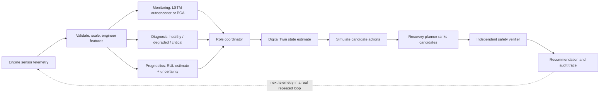

# Project Learning Notes: Digital Twin Verified Multi-Agent AI

These notes explain the project from the beginning, describe the current code and its files, interpret the outputs already generated in this workspace, and provide short answers for a project review or viva.

> **Scope statement:** This is a C-MAPSS research prototype for engine health monitoring and recovery recommendations. It is not a physical aircraft simulator, an aircraft-certified controller, or proof that a recovery action is effective in a real engine.

## 1. The project in one sentence

The project takes an engine's sensor history, estimates whether its behavior is unusual and how much useful life may remain, simulates candidate responses, checks those candidates against explicit safety rules, and records the decision path.

## 2. Start with the basic words

### Sensor telemetry

Telemetry is a sequence of measurements collected over time. In this project, a row represents one engine at one operating cycle. The columns include an engine ID, cycle number, three operating settings, and 21 sensor values.

### Machine learning (ML)

ML is a way to fit a model to examples. The model learns a relationship from training data and then predicts on data it did not fit on. Examples here are a Random Forest that estimates RUL and an LSTM autoencoder that learns normal sensor patterns.

### AI agent

An agent has a defined job, receives information, uses a model or rule to make a decision, and returns an action or recommendation. In this repository, “agent” means a role-based software component such as MonitoringAgent or RecoveryPlanningAgent. The coordinator connects those roles in a fixed, inspectable order. **These are not LLM agents and do not autonomously plan arbitrary tasks.**

The ML model is usually the part that learns patterns. The agent is the part that uses model output to perform a specific job. Some project roles use ML; others, like safety verification, are deterministic rules.

### Digital Twin

A Digital Twin is a software representation of a system that tracks or estimates its state and predicts how it may change. The project's Twin learns a one-step sensor transition from C-MAPSS trajectories and can run “what-if” simulations. It is a prototype Twin: C-MAPSS does not contain measured recovery-action outcomes, so the action effects used in those simulations are assumptions.

### Closed loop

A closed loop repeats a cycle of observe → estimate → decide → check → receive new telemetry. The demo runs one decision step and records the connected component outputs; it does not control an actual engine.

## 3. Problem and dataset

### Problem being studied

Engine sensor data changes as an engine degrades. The project asks whether a software pipeline can detect departures from healthy behavior, estimate Remaining Useful Life (RUL), compare possible responses, and reject responses that violate configured limits.

### NASA C-MAPSS data

C-MAPSS means Commercial Modular Aero-Propulsion System Simulation. It contains simulated turbofan engine trajectories, not measurements from a deployed aircraft. Each trajectory is indexed by engine unit and cycle. The raw telemetry columns are:

- `unit_id`: which simulated engine produced the row.
- `cycle`: the engine's time step.
- `op_setting_1` through `op_setting_3`: operating conditions.
- `sensor_1` through `sensor_21`: sensor measurements.
- Separate `RUL_FDxxx.txt` files provide the remaining-life label for each official test engine.

The project uses two subsets most heavily:

| Subset | Why it is used | Train engines | Test engines |
|---|---|---:|---:|
| FD001 | Development and end-to-end demonstrations; one operating condition and one degradation mode | 100 | 100 |
| FD004 | Harder evaluation; multiple operating conditions and degradation modes | 249 | 248 |

The workspace also contains FD002 and FD003, which are included in the data audit. The audit output you ran showed no missing or non-finite values, duplicate `(unit_id, cycle)` pairs, non-monotonic trajectories, or gaps in cycle sequences in any of the four subsets.

### RUL labels

RUL means “Remaining Useful Life,” measured in cycles. In a training trajectory that ends at failure, the basic target at cycle `t` is:

```text
RUL(unit, t) = final_cycle_of_unit - t
```

The test engines stop before failure. The separate RUL file gives the number of cycles remaining after the last observed test row, so the code combines that offset with the observed cycles when scoring predictions.

## 4. Architecture and information flow



### The seven roles/blocks

1. **Preprocessing:** checks data, removes constant training features where appropriate, fits a scaler on fit engines, and creates time windows.
2. **Monitoring:** asks whether a recent sensor window looks unlike early-life healthy behavior.
3. **Diagnosis:** maps the window to a project-defined health band. The main labels come from RUL thresholds, not NASA physical-fault labels.
4. **Prognostics:** predicts RUL and estimates prediction uncertainty.
5. **Digital Twin:** estimates the current state and predicts a next state for each candidate action under explicit assumptions.
6. **Recovery planner:** scores candidate actions and recommends an eligible one.
7. **Safety verifier:** independently approves or rejects outcomes based on hard configured limits. The planner cannot override a rejection.

The “three Digital Twin blocks” in the architecture—current-state estimation, data-driven model, and future-state prediction—are implemented as connected functions within the Twin module, not as three separately trained Twins.

## 5. How the important models work

### 5.1 Preprocessing and windows

Time matters: adjacent measurements from one engine are related. The code groups by engine and builds a window of 30 consecutive cycles. A window can be written as:

```text
X_t = [sensor values at cycles t-29, ..., t]
```

That gives a model recent history rather than a single isolated row. The scaler and feature selection are fitted on training engines only, then applied to held-out engines. This prevents information from evaluation engines influencing training.

### 5.2 Monitoring: LSTM autoencoder

An autoencoder tries to reconstruct its input. The LSTM version reads a sequence, compresses its temporal pattern, and reconstructs the sensor sequence. It is trained on early-life windows treated as healthy. If a later window reconstructs poorly, its mean squared reconstruction error is high and the window is considered anomalous.

The threshold is selected using a healthy calibration group (the configured 99th percentile in this run). The project requires three consecutive above-threshold windows to confirm an alert, which suppresses isolated spikes. It can use PyTorch; a deterministic NumPy fallback exists. PCA is retained as a classical baseline.

**Key distinction:** unusual behavior is an anomaly. An anomaly score alone does not identify a broken physical component.

### 5.3 Diagnosis: health-state classifier

The main diagnosis model is a histogram gradient-boosting classifier over summary features from the window: last value, mean, standard deviation, minimum, maximum, and slope. The target classes are created from RUL:

| Project label | Rule |
|---|---|
| `healthy` | RUL > 125 cycles |
| `degraded` | 25 < RUL ≤ 125 cycles |
| `critical` | RUL ≤ 25 cycles |

These are project-defined health bands. They are not labels supplied by NASA and do not identify component faults. Confidence and normalized entropy are also reported; if the confidence is too low or entropy too high, the classifier can return `uncertain`.

The separate synthetic classifier recognizes `normal`, `bias`, `drift`, `stuck`, or `spike` patterns created by the project. This experiment tests recognition of generated sensor corruptions—not physical engine diagnosis.

### 5.4 Prognostics: RUL prediction

The formal PrognosticsAgent defaults to a Random Forest model using window-derived features. The project also implements or compares a naive baseline, Ridge regression, a NumPy LSTM, XGBoost, a PyTorch temporal CNN, and a PyTorch Transformer. The sequence models use ordered windows directly; the classical models use engineered window summaries.

The selected model produces a point estimate. A separate set of held-out engines calibrates uncertainty. The report contains a symmetric conformal interval and a one-sided lower bound. In the decision path the Twin/planner receives the conservative lower bound rather than the true RUL. Ground-truth RUL is held back for scoring only.

`include_cycle_feature` is off by default. Cycle age helped MAE in grouped experiments, but it is kept opt-in because its calibrated lower-bound coverage was not consistently at the nominal 95% target.

### 5.5 Digital Twin transition model

The nominal transition model is a multi-output Ridge regression. Its input is the current normalized feature vector; its target is the next-cycle feature vector. It is trained on adjacent pairs from training engines.

For what-if planning, each action has explicit multipliers for sensor transition and degradation, plus a mission cost. For example, “reduce thrust” slows the assumed transition/degradation; “hold for inspection” reduces them more; “controlled shutdown” freezes the simulated state. These are documented assumptions because the dataset contains no action/outcome records.

The Twin estimates residual error from fitting and uses it in its uncertainty output. The one-step CV result compares model predictions against a simple persistence baseline (predict the next sensor value equals the current one). This evaluates observed no-action next-step trajectories, not counterfactual recovery actions or long-horizon accuracy.

### 5.6 Recovery planning and safety verification

The planner simulates a fixed set of registered actions, calculates a weighted objective using such quantities as risk and mission cost, filters candidates against its risk budget, and ranks the remaining options. This is an explainable constrained heuristic, not PPO and not a learned policy.

The SafetyVerifier is a separate deterministic gate. In this run it checks values such as failure risk, model uncertainty, projected drift, Twin violations, state validity, and whether shutdown is permitted. It returns approval plus explicit violation strings. “21/21 scenarios matched” means the rules behaved as expected on a designed synthetic scenario set; it does not mean the system is 100% safe.

### 5.7 Coordinator and closed loop

`HealthAgentCoordinator` runs monitoring and health diagnosis, then passes their evidence to the `ClosedLoopOrchestrator`. The orchestrator gets RUL predictions, estimates Twin state, asks for candidate outcomes, verifies each outcome, and returns the selected recommendation and rationale.

The coordinator accepts telemetry only and explicitly rejects a frame containing the `rul` target. It also abstains if there are too few cycles for a 30-cycle window or if uncertainty has not been calibrated. These checks help keep labels out of the decision path and avoid pretending the system has enough information when it does not.

## 6. What your run produced

### Dataset audit

Your audit covered FD001–FD004. It reported zero missing values, non-finite values, duplicate engine-cycle pairs, non-monotonic units, and non-contiguous trajectories. Constant sensors were identified and can be removed where the training fit calls for it.

### LSTM MonitoringAgent

On the FD001 official test split, 33 engines had degraded windows. The detector raised an alert on 84.8% of those engines, with a 4.36% healthy-window false-alarm rate and a median lead time of 65 cycles. “84.8%” is the engine detection rate among engines with degradation windows; the separate pooled window recall is about 65.9%. These are different denominators, so do not call either one simply “the accuracy.”

Validation detected all 20 validation engines that had degraded windows, with a 4.03% healthy-window false-alarm rate. Test results are more important for generalization; perfect validation detection does not mean perfect future performance.

The comparison reported 2% PCA engine detection versus 84.8% LSTM on this split and alert protocol. That supports the LSTM for this particular anomaly-monitoring setup; it is not proof of physical fault identification.

### DiagnosisAgent

The validation window metrics were accuracy 0.784, balanced accuracy 0.791, and macro-F1 0.784. These describe the three project-defined health bands over validation windows.

The printed terminal-engine accuracy of 1.000 with macro-F1 0.333 is not evidence of good three-class diagnosis: terminal rows have a single end-of-life health label, so accuracy can be 1.0 while the macro score over all three classes is low because the other classes are absent. Use the window-level metrics when describing this classifier.

### PrognosticsAgent

FD001 official test terminal-engine results:

| Metric | Result | Plain meaning |
|---|---:|---|
| MAE | 20.52 cycles | Average absolute RUL error; lower is better |
| RMSE | 28.09 cycles | Error metric that penalizes large misses more; lower is better |
| R² | 0.543 | Variation explained relative to a constant-mean prediction; not “54.3% accuracy” |
| Calibrated interval coverage | 97.0% | Fraction of scored targets inside the reported interval |

The same training command also printed a single official-test comparison in which the LSTM benchmark MAE (18.65 cycles) was lower than the RF MAE (20.61 cycles). The five-fold grouped comparison is a different protocol on different engine groups: RF MAE 37.31, NumPy LSTM 37.79, CNN 38.50, Transformer 38.55, XGBoost 36.96, and RF + cycle feature 33.42 on FD001. The paired intervals for XGBoost/LSTM/CNN/Transformer included zero versus RF; that evaluation does not establish they beat RF. Do not compare these MAEs as if they came from the same split.

FD004 official-test pipeline results were MAE 26.74 cycles, RMSE 36.73, and R² 0.524. One-sided lower-bound coverage was 93.7%, below the nominal 95% target. 237 of 248 engines were scored at terminal time; 11 had shorter histories than the 30-cycle minimum and were left unscored. That is an explicit model input limit, not missing evaluation data silently filled in.

### Digital Twin

FD004 five-fold engine-grouped one-step transition CV produced normalized sensor RMSE 0.999 versus 1.415 for persistence, across 249 held-out engines. Lower is better, so the fitted transition was more accurate than the simple baseline on these observed transitions. This result does not validate the Twin's action effects.

### Synthetic corruption and safety scenarios

The synthetic corruption classifier scored 73.3% accuracy / 0.743 macro-F1 on FD001 and 81.4% / 0.816 on FD004. These metrics are for generated normal/bias/drift/stuck/spike examples, not real component failures.

The SafetyVerifier matched all 21 expected synthetic scenarios and rejected all 5 invalid policy configurations. This checks implementation behavior against the specified rules, not real-world reliability.

### Action-sensitivity experiment

When configured action benefits were removed, the selected recommendation changed in 45.0% of FD001 and 55.7% of FD004 development decisions. This means the planner's choices depend materially on assumed action effects. It does not mean those actions caused those outcomes in an engine.

### One closed-loop demo trace

The LSTM closed-loop example used unit 3 at cycle 156:

| Step | Demo output | Explanation |
|---|---|---|
| Monitoring | Anomaly score 3.116 | The score measures departure from learned normal patterns; its own scale is model-specific. |
| Diagnosis | `degraded`, confidence 0.845 | Project health band, not physical component fault. |
| Prognostics | Predicted RUL 30.23 cycles | Point estimate from the prognostics model. |
| Calibration for planning | Lower 95% bound 0.0 cycles | Conservative bound used for the decision; it can be much lower than the point estimate. |
| Safety + planner | `controlled_shutdown` recommended | Other simulated actions were rejected by the configured horizon/risk rules. |
| Scoring only | Actual RUL 23 cycles | Used after the decision to evaluate the prediction, not passed to the planner. |

The shutdown is a simulated recommendation under this configuration. It is not a real operating instruction or evidence that a real engine should be shut down.

## 7. Metrics: quick glossary

| Term | Meaning | Good direction / caution |
|---|---|---|
| MAE | Mean absolute prediction error | Lower is better; RUL MAE is in cycles |
| RMSE | Root mean squared error | Lower is better; gives larger errors extra influence |
| R² | Fit relative to a mean-only predictor | Higher can be better; not a percentage accuracy |
| Accuracy | Fraction of labels predicted correctly | Can hide rare-class failure or class imbalance |
| Balanced accuracy | Average recall across classes | Helps when class counts differ |
| Macro-F1 | Average F1 across classes equally | Shows per-class balance; undefined/low for absent classes depending on reporting convention |
| Detection rate | Share of degraded engines or windows that were alerted | Always state whether denominator is engines or windows |
| False-alarm rate | Share of healthy windows incorrectly alerted | Lower is better, but overly strict thresholds may miss degradation |
| Lead time | Cycles between first confirmed alert and the estimated failure point | More warning may help, but must be read with false alarms |
| Interval coverage | Share of actual RUL values inside an interval | Compare with nominal target and interval width; coverage alone can be made high with very wide intervals |
| Normalized sensor RMSE | Prediction error after feature scaling | Unitless normalized scale; compare only with the same protocol/baseline |

## 8. Which files do what?

### Main application code: `src/`

| File | Purpose |
|---|---|
| `src/cmapss_data.py` | Loads C-MAPSS files, creates RUL labels, splits by engine, fits/transforms scaling, builds windows, and summarizes windows. |
| `src/monitoring.py` | PCA monitoring baseline and event-level alert evaluation helpers. |
| `src/lstm_monitoring.py` | LSTM autoencoder monitor, NumPy fallback, data preparation, training, thresholding, and alert scoring. |
| `src/diagnosis.py` | RUL-derived health-state labels, gradient-boosting diagnosis, probabilities, confidence/entropy, and synthetic benchmark utilities. |
| `src/prognostics.py` | RUL models, configs, sequence models, fit/predict interfaces, uncertainty calibration, metrics, and candidate benchmarking. |
| `src/digital_twin.py` | Action definitions, Twin state and outcomes, learned one-step Ridge transition, and what-if outcome simulation. |
| `src/recovery_planning.py` | Weighted objective, risk filtering, and ranking of candidate actions. |
| `src/safety_verification.py` | Independent deterministic policy thresholds, constraint checks, and approval/rejection records. |
| `src/closed_loop.py` | Connects prognostics, Twin, planner, and safety verifier for one decision; supports safe abstention. |
| `src/agent_coordinator.py` | Connects monitoring and diagnosis to the closed-loop orchestrator and writes a role-by-role trace. |
| `src/fault_injection.py` | Adds controlled synthetic bias, drift, stuck-value, or spike patterns to a sensor window. |
| `src/synthetic_fault_diagnosis.py` | Random Forest classifier for the generated corruption labels; not a physical-fault classifier. |
| `src/__init__.py` | Marks `src` as a Python package. |

### Commands and experiments: `scripts/`

Run modules from the project root as `python -m scripts.NAME`. The scripts use reusable code in `src/`.

**First steps and demos**

| Script | What it runs |
|---|---|
| `scripts/__init__.py` | Makes the scripts folder runnable as a package with `python -m scripts.NAME`. |
| `audit_cmapss.py` | Checks dataset rows, units, missing/non-finite values, duplicate cycles, sequence continuity, and constant sensors. |
| `profile_fd001.py` | Profiles FD001 and demonstrates leakage-safe window creation. |
| `train_rul_baseline.py` | Fits and evaluates the early classical RUL baseline. |
| `evaluate_fd001_test.py` | Scores a frozen FD001 baseline on official test engines. |
| `run_monitoring_baseline.py` | Runs the PCA monitoring baseline. |
| `train_lstm_monitoring.py` | Trains and evaluates the LSTM monitoring agent, compares PCA, and saves model/reports. |
| `train_diagnosis_baseline.py` | Trains and reports the project-defined health-state classifier. |
| `train_prognostics_agent.py` | Trains/evaluates the formal FD001 PrognosticsAgent and prints a model benchmark. |
| `demo_digital_twin.py` | Fits and demonstrates current state estimation and candidate Twin outcomes. |
| `demo_recovery_planner.py` | Shows action scores, selected action, and rejected candidates. |
| `demo_agent_pipeline.py` | Demonstrates Prognostics → Twin → Planner without exposing actual RUL to decisions. |
| `demo_closed_loop.py` | Runs the connected monitoring/diagnosis/prognostics/Twin/planner/safety pipeline; optional `--monitor-backend lstm`. |
| `show_project_summary.py` | Prints a concise summary from saved JSON reports; it does not retrain or rerun experiments. |

**Core evaluations**

| Script | What it evaluates |
|---|---|
| `evaluate_fd004_pipeline.py` | Harder FD004 prognostics, uncertainty, Twin one-step validation, and demo decision. |
| `evaluate_safety_verifier.py` | Deterministic safety rules against fixed synthetic boundary and malformed-input scenarios. |
| `evaluate_prognostics_agent_models_cv.py` | Five-fold grouped comparison of RF, XGBoost, RF + cycle age, NumPy LSTM, CNN, and Transformer. |
| `evaluate_digital_twin_transition_cv.py` | Five-fold engine-grouped Twin next-step prediction against persistence. |
| `evaluate_synthetic_fault_diagnosis.py` | Held-out-engine classification of generated sensor corruptions. |
| `analyze_action_assumption_sensitivity.py` | Measures how changing assumed action benefits changes recommendations. |
| `run_research_evaluation.py` | Grouped engine-level baseline comparisons and feature/window/model ablations. |
| `evaluate_closed_loop_development.py` | Evaluates decisions at fixed telemetry milestones on development engine groups. |
| `evaluate_closed_loop_candidate_models.py` | Compares prognostics choices inside the closed-loop development workflow. |

**Focused FD004/robustness studies**

| Script | Question it studies |
|---|---|
| `compare_fd004_prognostics_models.py` | How selected RUL models compare under FD004 grouped folds. |
| `analyze_fd004_rul_errors.py` | Where FD004 RUL errors occur by cycle, RUL band, and operating-condition grouping. |
| `evaluate_fd004_bias_calibration.py` | Whether cross-fitted isotonic point calibration improves FD004 predictions. |
| `evaluate_fd004_cycle_age_feature.py` | Whether engine age helps FD004 RUL prediction under grouped CV. |
| `evaluate_fd004_cycle_age_holdout.py` | One reserved development holdout comparison with and without cycle age. |
| `evaluate_fd004_cycle_conditioned_calibration.py` | Exploratory milestone-specific FD004 lower-bound margins on the inspected holdout. |
| `evaluate_fd004_cycle_conditioned_cv.py` | Grouped cross-validation of FD004 milestone-specific calibration. |
| `evaluate_fd001_cycle_conditioned_cv.py` | Corresponding grouped calibration study for FD001. |
| `evaluate_prognostics_robustness.py` | Effects of shorter histories and cross-fitted bias correction on FD004. |

There is no single command that retrains every model and reruns every research experiment. The two presentation commands are for a compact live demo and saved-result summary; the evaluation scripts are separate experiments.

### Tests: `tests/`

Tests are small checks of software contracts, not model accuracy claims:

| File | Checks |
|---|---|
| `test_cmapss_data.py` | Data splits, label creation, scaling/window invariants, and leakage checks. |
| `test_monitoring.py` | Monitoring behavior and alert logic. |
| `test_diagnosis.py` | Health-band labels, diagnosis outputs, and uncertainty behavior. |
| `test_prognostics.py` | RUL model interfaces, sequence models, and prediction behavior. |
| `test_digital_twin.py` | Twin state and simulation behavior. |
| `test_safety_verification.py` | Safety constraints and invalid inputs. |
| `test_agent_coordinator.py` | Coordinator inputs, role handoffs, and no-RUL-leakage contract. |
| `test_fault_injection.py` | Synthetic corruption generation. |
| `test_synthetic_fault_diagnosis.py` | Synthetic classifier input/output contract. |
| `test_action_assumption_sensitivity.py` | Action multiplier sensitivity helpers. |
| `test_research_evaluation.py` | Reproducible grouped evaluation helpers. |
| `tests/__init__.py` | Marks tests as a Python package. |

The recent project run reported 39 tests passing. A passing unit test means the checked code behavior works for those cases; it does not prove that a model is physically accurate or safe.

### Other project files

| Path | Purpose |
|---|---|
| `README.md` | Full setup, command reference, reported results, and scope limitations. |
| `.gitignore` | Tells Git which generated/local files to omit from version control. |
| `docs/project_spec.md` | Research objective, component contracts, evaluation protocol, and claim boundary. |
| `requirements.txt` | Core Python data and ML dependencies. |
| `requirements-torch.txt` | Optional PyTorch dependency declaration for sequence models / LSTM backend. |
| `requirements-model-comparison.txt` | Core requirements plus optional XGBoost for model comparisons. |
| `data/raw/cmapss/train_FD001.txt` etc. | Training telemetry for FD001–FD004. |
| `data/raw/cmapss/test_FD001.txt` etc. | Truncated test telemetry for FD001–FD004. |
| `data/raw/cmapss/RUL_FD001.txt` etc. | RUL offsets for official test engines. |
| `data/raw/cmapss/CMAPSSData.zip` | Original downloaded archive. |
| `data/raw/cmapss/readme.txt` and PDF | Dataset documentation supplied with the dataset. |
| `models/fd001_lstm_monitoring.pt` | Saved LSTM autoencoder used by the closed-loop LSTM demo. |
| `models/fd001_prognostics_agent.joblib` | Saved FD001 PrognosticsAgent model. |
| `models/fd001_diagnosis_baseline.joblib` | Saved health-state classifier. |
| `models/fd001_digital_twin.joblib` | Saved nominal one-step transition model. |
| `models/fd001_lstm_monitoring_verified/fd001_lstm_monitoring.pt` | Separately saved verified LSTM monitoring run. |
| `reports/generated/*.json` | Structured summaries, metrics, configurations, and decision traces. |
| `reports/generated/*.csv` | Detailed predictions, per-engine events, errors, and state-level results. |
| `interim_presentation_output/` | Presentation exports; not needed to run the Python project. |

### Main generated report files

| Report | What to look at |
|---|---|
| `fd001_lstm_monitoring.json` | LSTM monitoring configuration, validation/test metrics, alert definitions, and PCA comparison. |
| `fd001_lstm_monitoring_validation_events.csv`, `fd001_lstm_monitoring_test_events.csv` | Engine/cycle alert events behind the LSTM monitor summary. |
| `fd001_diagnosis_baseline.json` | Health-band classifier metrics, class distributions, and calibration output. |
| `fd001_prognostics_agent.json` | FD001 RUL metrics, uncertainty coverage, model configuration, and candidate benchmark. |
| `fd001_prognostics_per_engine_test.csv` | Per-engine FD001 test error details. |
| `fd001_prognostics_agent_models_cv.json` and `fd004_prognostics_agent_models_cv.json` | Grouped cross-validation comparisons for prognostics model candidates. |
| `fd001_closed_loop_demo.json` and `fd001_closed_loop_demo_lstm.json` | One-step closed-loop traces using PCA or LSTM monitoring. |
| `fd001_digital_twin_demo.json`, `fd001_recovery_planner_demo.json`, `fd001_agent_pipeline_demo.json` | Individual Twin, planner, and prognostics-to-planner demonstration traces. |
| `fd004_pipeline_evaluation.json` | FD004 test metrics, uncertainty, one-step Twin result, and example decision. |
| `fd004_terminal_engine_errors.csv`, `fd004_unscored_test_engines.csv` | Per-engine FD004 errors and engines that did not meet the minimum history length. |
| `fd001_digital_twin_transition_cv.json`, `fd004_digital_twin_transition_cv.json` | Engine-grouped Twin transition metrics against persistence. Their paired CSVs hold the predictions. |
| `safety_verifier_scenarios.json` and `.csv` | Designed safety-rule scenarios and their expected/actual approvals. |
| `synthetic_fault_diagnosis.json` and `synthetic_fault_diagnosis_predictions.csv` | Metrics and predictions for generated sensor-corruption patterns. |
| `action_assumption_sensitivity.json` and `action_assumption_sensitivity_states.csv` | How recommendations change across simulated action-benefit assumptions. |
| `research_evaluation.json`, `grouped_cv_fd001.json`, and corresponding CSV files | Grouped model/feature/window comparisons and their per-fold or per-engine details. |

In general, JSON is the readable summary; a similarly named CSV contains detailed rows for plotting, auditing, or tracing an individual engine.

## 9. How to run the project for learning and presentation

Open PowerShell in the repository root:

```powershell
cd "C:\Users\deven\OneDrive\Desktop\new-project"
```

### Main integrated demonstration

```powershell
python -m scripts.demo_closed_loop --monitor-backend lstm
```

This runs one connected example. It uses the already-trained LSTM monitor saved under `models/`, and fits the other pieces needed for that demo. It prints the anomaly score, health state, RUL estimate, safety decisions, and action recommendation.

Immediately before calling the coordinator, the current demo also prints the first five and last five rows of the example engine's raw telemetry and normalized feature preview. To keep the terminal readable, it splits the complete selected feature set into narrow column groups. The `rul` label is excluded from telemetry sent into the agents.

### Clean summary of the evaluation results

```powershell
python -m scripts.show_project_summary
```

This reads reports already in `reports/generated/`. It does not rerun training or cross-validation. If reports are absent on another machine, run the associated training/evaluation scripts first.

### Starting from data checks and fitting the main modules

```powershell
python -m scripts.audit_cmapss
python -m scripts.train_lstm_monitoring
python -m scripts.train_diagnosis_baseline
python -m scripts.train_prognostics_agent
```

The broader evaluation commands are listed in the README. They can take longer than the live demonstration and need not be rerun during a presentation if the saved reports are available.

## 10. Questions a reviewer may ask

### “What problem are you solving?”

We are building a research prototype that analyzes simulated turbofan sensor histories, estimates engine health and remaining life, explores recovery recommendations in a Twin, and applies explicit safety rules before presenting a recommendation.

### “Why did you use C-MAPSS?”

It provides multivariate sensor trajectories and RUL labels for a reproducible turbofan prognostics benchmark. FD001 is a manageable development subset; FD004 adds multiple operating conditions and degradation modes. It is simulated data, so we do not claim direct proof on aircraft.

### “Are these real AI agents or just ML models?”

The system contains ML models inside role-based agents. Monitoring and prognostics use learned models; diagnosis uses a classifier; the Twin has a learned nominal transition; planning and safety are rule/optimization components. A deterministic coordinator invokes the roles and records handoffs. This is a multi-agent software architecture, not open-ended LLM autonomy.

### “What is the difference between monitoring and diagnosis?”

Monitoring detects that a signal differs from a learned healthy pattern. Diagnosis assigns a health-state label. Our main labels are RUL-derived bands; they are not physical component-fault labels.

### “What does the LSTM do?”

The LSTM autoencoder learns to reconstruct sequences of healthy early-life telemetry. Reconstruction error provides an anomaly score. A separate LSTM option also exists for RUL prediction, but the production/default PrognosticsAgent is Random Forest in the current configuration.

### “Why use 30 cycles?”

The project uses a 30-cycle history window as its configured sequence length. It gives models recent temporal context and creates a clear minimum-history contract. The system abstains if it has fewer cycles instead of silently inventing missing history.

### “How did you prevent data leakage?”

We split whole engine IDs into fit, calibration, and evaluation groups. Rows/windows from the same engine are not randomly divided across those groups. Scalers and feature selection are fit on training engines only. The coordinator also rejects the RUL target column in telemetry inputs.

### “Why do you need uncertainty?”

A single RUL value hides the model's error. Calibration estimates how wide an interval or conservative lower bound should be on held-out engines. The planner uses the lower bound to make its decision more cautious. Coverage is still imperfect, especially on FD004, and is not a safety guarantee.

### “What does MAE 20.5 cycles mean?”

Across the scored FD001 test terminal engines, the predicted RUL differed from the actual RUL by 20.5 cycles on average in absolute value. It does not mean 20.5% error or 79.5% accuracy.

### “Why does the dashboard/demo sometimes choose shutdown when predicted RUL is 30?”

The point prediction and the planning lower bound are different. In the example, the point prediction was about 30 cycles, but the calibrated one-sided lower bound was 0. The safety rules rejected continued-operation candidates for that simulated horizon; the planner selected the allowed fallback. It is a configured demo result, not an instruction for a real engine.

### “Is the Digital Twin validated?”

Its nominal one-step sensor prediction was evaluated with engine-grouped cross-validation against persistence. Its action effects and long-horizon counterfactual behavior are not validated because C-MAPSS does not provide action/outcome data.

### “What does 21/21 safety scenarios prove?”

It shows the verifier matched the expected result on 21 hand-designed rule scenarios and rejected five invalid policies. It does not estimate the chance of an accident, certify a real system, or prove physical safety.

### “Why not PPO?”

PPO is not required to demonstrate the current architecture. More importantly, the action simulator has assumed action effects, not measured outcomes. Training reinforcement learning against unvalidated effects could produce convincing but misleading results. The current constrained heuristic is transparent and auditable.

### “What is the biggest limitation?”

There are no physical fault labels or measured recovery-action outcomes in the used benchmark. Therefore the project can evaluate RUL and anomaly behavior on C-MAPSS, but it cannot demonstrate real component diagnosis or real action efficacy/safety.

### “What is complete and what remains research work?”

The prototype implements data preprocessing, monitoring, RUL-derived health classification, RUL prediction, a one-step nominal Twin, action-assumption what-if planning, a separate safety gate, and a closed-loop trace, with grouped evaluation and saved evidence. Independent physical validation, real fault labels, measured action outcomes, long-horizon Twin validation, broader tuning, and operational certification remain outside the current scope.

## 11. A short presentation script

> “Our project is a C-MAPSS-based research prototype for turbofan health management. The data layer creates engine-specific sensor windows without mixing engines across training and evaluation. The LSTM autoencoder monitors deviations from healthy patterns, the diagnosis module assigns RUL-derived health bands, and the prognostics model estimates remaining useful life with uncertainty. A data-driven one-step Twin predicts nominal sensor changes and simulates explicitly assumed action effects. The planner ranks candidate actions, then a separate deterministic verifier rejects candidates that violate configured constraints. We evaluated the components on held-out engines. The main limitation is that C-MAPSS has no measured recovery actions or physical fault labels, so our action effects and component-diagnosis claims are not validated in real engines.”

## 12. One-line summary to remember

**The project is an explainable, role-based C-MAPSS research prototype that links anomaly monitoring and RUL prediction to Twin-based what-if planning and deterministic safety checks; its action effects remain assumptions.**
